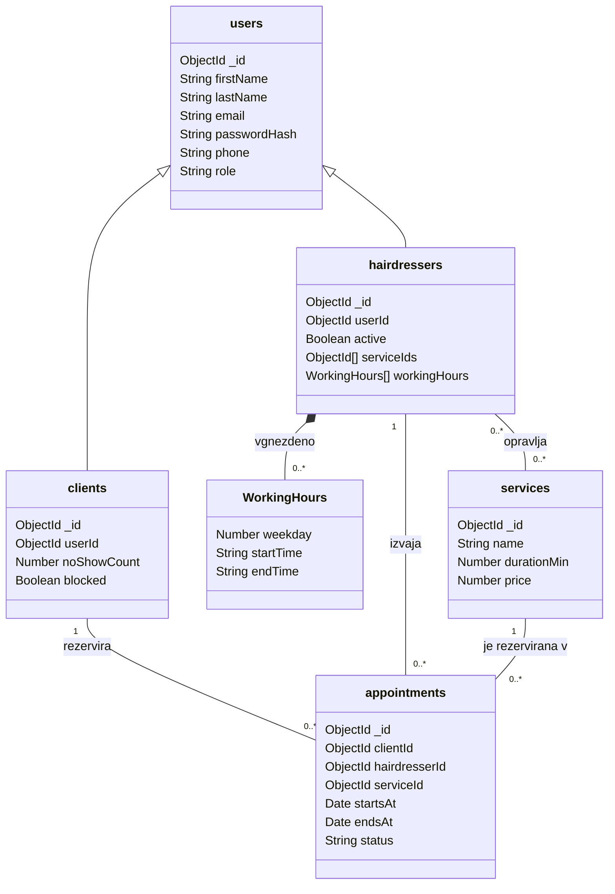

# 03 – Podatkovni model

Podatkovna baza: **MongoDB** (dokumentna baza). Podatki so shranjeni kot dokumenti v zbirkah (collections), povezave med zbirkami pa kot reference (`ObjectId`). Sheme so definirane z Mongoose.

## Entitete in glavna polja

### Zbirka `users` (uporabniki)

Vsi računi, s katerimi se je mogoče prijaviti (stranke, frizerji in administrator). Vsebuje podatke za prijavo in kontaktne podatke, ki jih imajo vse vloge.

| Polje        | Tip                                            |
| ------------ | ---------------------------------------------- |
| \_id         | ObjectId                                       |
| firstName    | String                                         |
| lastName     | String                                         |
| email        | String, unikaten                               |
| passwordHash | String                                         |
| phone        | String                                         |
| role         | String, enum: `CLIENT`, `HAIRDRESSER`, `ADMIN` |
| createdAt    | Date                                           |

### Zbirka `clients` (stranke)

Profil stranke za uporabnika z vlogo `CLIENT`.

| Polje       | Tip                          |
| ----------- | ---------------------------- |
| \_id        | ObjectId                     |
| userId      | ObjectId → `users`, unikaten |
| noShowCount | Number                       |
| blocked     | Boolean                      |

### Zbirka `hairdressers` (frizerji)

Profil frizerja za uporabnika z vlogo `HAIRDRESSER`.

| Polje        | Tip                                                            |
| ------------ | -------------------------------------------------------------- |
| \_id         | ObjectId                                                       |
| userId       | ObjectId → `users`, unikaten                                   |
| active       | Boolean                                                        |
| serviceIds   | Array ObjectId → `services` (storitve, ki jih frizer opravlja) |
| workingHours | Array poddokumentov `WorkingHours`                             |

### `WorkingHours` (delovni čas, vgnezden v `hairdressers`)

Tedenski delovni čas frizerja, shranjen kot seznam v dokumentu frizerja.

| Polje     | Tip                                   |
| --------- | ------------------------------------- |
| weekday   | Number (1 = ponedeljek … 7 = nedelja) |
| startTime | String (npr. `"09:00"`)               |
| endTime   | String (npr. `"13:00"`)               |

### Zbirka `services` (storitve)

| Polje       | Tip                                  |
| ----------- | ------------------------------------ |
| \_id        | ObjectId                             |
| name        | String                               |
| description | String                               |
| durationMin | Number (minute, vnese administrator) |
| price       | Number (centi)                       |
| active      | Boolean                              |

### Zbirka `appointments` (termini)

| Polje              | Tip                                                            |
| ------------------ | -------------------------------------------------------------- |
| \_id               | ObjectId                                                       |
| clientId           | ObjectId → `clients`                                           |
| hairdresserId      | ObjectId → `hairdressers`                                      |
| serviceId          | ObjectId → `services`                                          |
| startsAt           | Date                                                           |
| endsAt             | Date (= startsAt + durationMin storitve)                       |
| price              | Number (centi)                                                 |
| status             | String, enum: `CONFIRMED`, `CANCELLED`, `COMPLETED`, `NO_SHOW` |
| clientNote         | String                                                         |
| cancellationReason | String                                                         |
| createdAt          | Date                                                           |

## Povezave

| Povezava                    | Kardinalnost | Izvedba                                     |
| --------------------------- | ------------ | ------------------------------------------- |
| users – clients             | 1 : 0..1     | referenca `clients.userId`                  |
| users – hairdressers        | 1 : 0..1     | referenca `hairdressers.userId`             |
| clients – appointments      | 1 : N        | referenca `appointments.clientId`           |
| hairdressers – appointments | 1 : N        | referenca `appointments.hairdresserId`      |
| services – appointments     | 1 : N        | referenca `appointments.serviceId`          |
| hairdressers – services     | M : N        | seznam referenc `hairdressers.serviceIds`   |
| hairdressers – WorkingHours | 1 : N        | vgnezden seznam `hairdressers.workingHours` |

Administrator ima samo dokument v zbirki `users`.

## Diagram podatkovnega modela

UML diagram razredov: puščica s praznim trikotnikom pomeni generalizacijo (`clients` in `hairdressers` sta vrsti uporabnikov), poln romb pomeni vgnezdene podatke, številke na koncih povezav pa kardinalnost.

