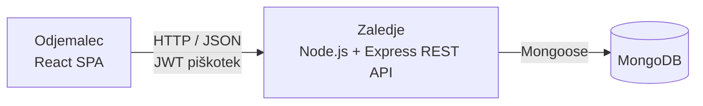

# 04 – Arhitektura in tehnološki sklad

## Arhitektura

### Glavni deli sistema

- **Odjemalec (frontend)** – enostranska spletna aplikacija, ki jo v brskalniku uporabljajo vse vloge.
- **Zaledje (backend)** – REST API s poslovno logiko (avtentikacija, izračun prostih terminov, rezervacija, preklic, spremembe statusov, administracija).
- **Podatkovna baza** – MongoDB, do katere dostopa samo zaledje.

### Komunikacija

- Odjemalec ↔ zaledje: zahteve HTTP s podatki JSON na REST API (`/api/...`).
- Zaledje ↔ baza: gonilnik MongoDB prek knjižnice Mongoose.

### Podatkovna baza

MongoDB 7 z zbirkami `users`, `clients`, `hairdressers`, `services` in `appointments`. Podatkovni model je opisan v `03-podatkovni-model.md`. Baza je lokalno nameščen MongoDB (Community Server), ki teče kot replica set z enim vozliščem, ker transakcije delujejo samo na replica setu.

### Avtentikacija in upravljanje uporabnikov

- Stranke se registrirajo same (v isti transakciji se ustvarita dokument v `users` in profil v `clients`); račune frizerjev ustvari administrator (`users` in `hairdressers`); prvi administrator se ustvari s skripto seed.
- Podatki ob registraciji se preverijo z Zod: vsa polja so obvezna, e-pošta mora biti veljavna in unikatna, telefonska številka lahko vsebuje 6–20 števk, presledkov in znakov `+()-`, geslo pa mora imeti vsaj 6 znakov.
- Gesla so shranjena kot zgoščene vrednosti bcrypt.
- Po prijavi zaledje izda JWT, shranjen v piškotku httpOnly.
- Zaledje pri vsaki zahtevi preveri vlogo uporabnika in lastništvo podatkov.

### Lokalni zagon

Predpogoji: Node.js 20, npm in lokalno nameščen MongoDB 7 (Community Server).

```bash
# enkrat: v mongod.cfg nastavite replication.replSetName: rs0, ponovno zaženite MongoDB in v mongosh izvedite rs.initiate()
# v backend/.env: MONGODB_URI=mongodb://localhost:27017/salonko?replicaSet=rs0
npm install
npm run db:seed           # vnese testne podatke in račun administratorja
npm run dev               # zaledje na :3000, odjemalec na :5173
```

### Diagram



## Tehnološki sklad

| Področje             | Tehnologije                                          |
| -------------------- | ---------------------------------------------------- |
| Odjemalec (frontend) | React, TypeScript, Vite, React Router, Tailwind CSS  |
| Zaledje (backend)    | Node.js, Express, TypeScript, Zod (validacija vhoda) |
| Podatkovna baza      | MongoDB, Mongoose                                    |
| Avtentikacija        | JWT (jsonwebtoken), bcrypt                           |
| Lokalni razvoj       | npm, ESLint, Prettier                                |
| Testiranje           | Vitest, Supertest                                    |
| Upravljanje različic | Git, GitHub                                          |

## Arhitekturne odločitve

Vsaka odločitev je podrobneje opisana kot ADR v mapi [`adr/`](adr/) (kontekst, obravnavane možnosti, utemeljitev in posledice).

| ADR                                                    | Odločitev                                               | Zakaj                                                                                                                                                    |
| ------------------------------------------------------ | ------------------------------------------------------- | -------------------------------------------------------------------------------------------------------------------------------------------------------- |
| [0001](adr/0001-spa-in-rest-api.md)                    | SPA v Reactu in ločen REST API                          | Ločuje uporabniški vmesnik od poslovne logike, rezervacija deluje brez ponovnega nalaganja strani, API pa lahko kasneje uporabi tudi mobilna aplikacija. |
| [0002](adr/0002-typescript.md)                         | TypeScript na odjemalcu in zaledju                      | En jezik za celoten projekt; preverjanje tipov napake ujame že pred zagonom kode.                                                                        |
| [0003](adr/0003-mongodb.md)                            | MongoDB                                                 | Dokumenti v obliki, podobni JSON, ustrezajo projektu v JavaScriptu; delovni čas lahko shranimo v dokumentu frizerja; shemo razširjamo brez migracij.     |
| [0004](adr/0004-mongoose.md)                           | Mongoose                                                | Doda sheme, preverjanje podatkov in povezave med zbirkami.                                                                                               |
| [0005](adr/0005-jwt-v-piskotku.md)                     | JWT v piškotku httpOnly                                 | Strežnik ne potrebuje sej, JavaScript pa piškotka ne more prebrati, zato ga napad XSS ne more ukrasti.                                                   |
| [0006](adr/0006-locene-zbirke-strank-in-frizerjev.md)  | Ločeni zbirki `clients` in `hairdressers` poleg `users` | `users` vsebuje samo skupne podatke za prijavo, vsaka vrsta uporabnika ima svoje podatke, termini pa so povezani neposredno s stranko in frizerjem.      |
| [0007](adr/0007-vgnezden-delovni-cas.md)               | Delovni čas vgnezden v dokumentu frizerja               | Pripada samo enemu frizerju in se vedno bere skupaj z njim.                                                                                              |
| [0008](adr/0008-storitve-frizerja-kot-reference.md)    | Storitve frizerja kot seznam referenc                   | Seznam je kratek, storitve pa ostanejo v svoji zbirki, ker jih uporabljajo tudi termini.                                                                 |
| [0009](adr/0009-preprecevanje-prekrivanja-terminov.md) | Preprečevanje prekrivanja terminov s transakcijo        | MongoDB nima omejitve za prekrivanje časov; dve hkratni rezervaciji pri istem frizerju pišeta v isti dokument frizerja, zato uspe samo ena.              |
| [0010](adr/0010-izracun-prostih-terminov.md)           | Prosti termini se izračunajo, ne shranjujejo            | Vedno se ujemajo s trenutnim delovnim časom in termini.                                                                                                  |
