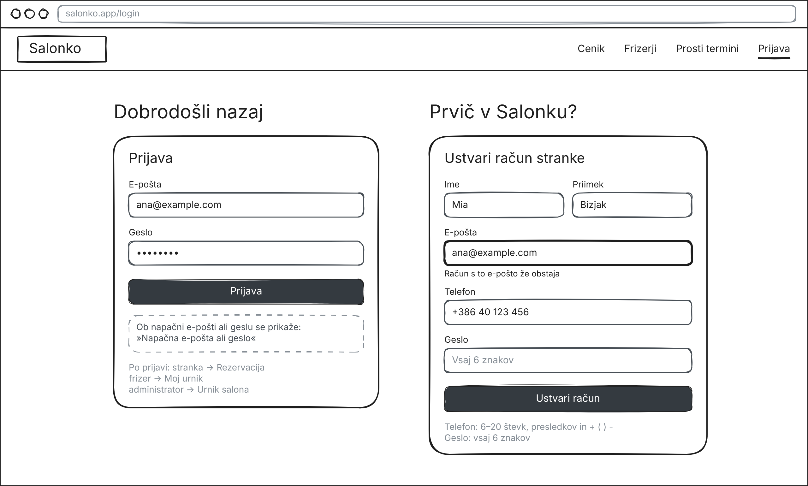
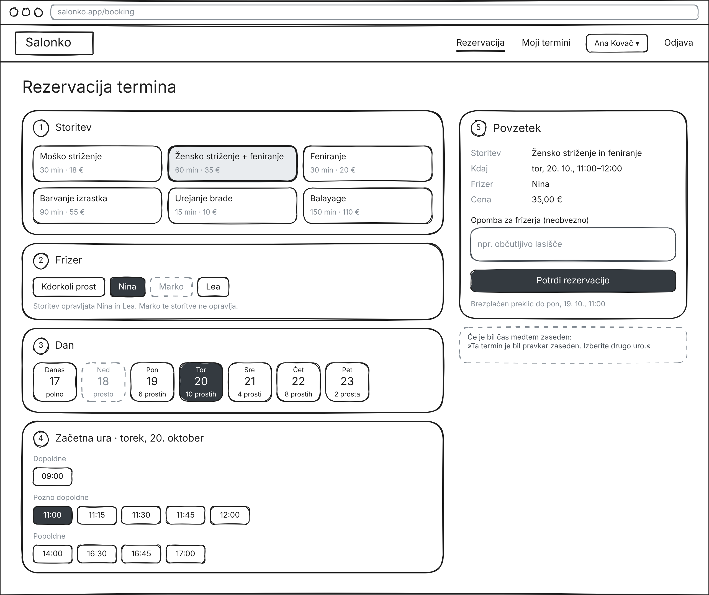
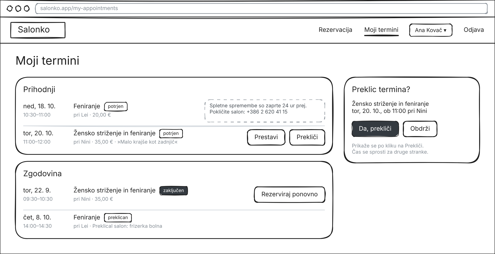
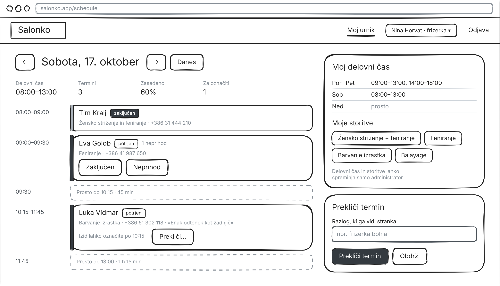
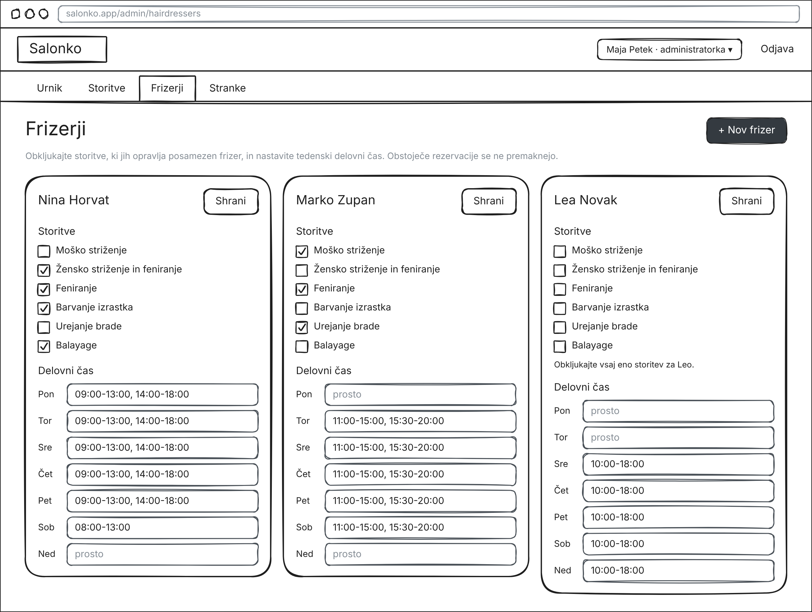

# 05 – Wireframes

Wireframi nizke ločljivosti za glavne zaslone aplikacije Salonko, po en za vsako vlogo. Slike so v mapi `images/` poleg tega dokumenta.

## 1. Prijava in registracija (gost)

Javna začetna stran. Levo gost vidi cenik s trajanjem in ceno vsake storitve. Desno sta obrazec za prijavo in obrazec za ustvarjanje računa stranke. Obrazec za registracijo prikazuje napako pri e-pošti, ki je že v uporabi.

Povezane zgodbe: US-01, US-02.

## 2. Rezervacija termina (stranka)

Čarovnik za rezervacijo v petih korakih: storitev, frizer, dan, začetna ura in povzetek. Frizerji, ki izbrane storitve ne opravljajo, so sivi, dnevi brez prostih ur pa onemogočeni. Ponujene so samo začetne ure, pri katerih celotna 60-minutna storitev ustreza prostemu času (npr. 11:00–12:00). Povzetek pred potrditvijo prikaže uro konca, ceno in rok za brezplačen preklic.

Povezane zgodbe: US-07, US-08.

## 3. Moji termini (stranka)

Prihodnji termini in zgodovina stranke. Termina, ki se začne čez manj kot 24 ur, ni mogoče spremeniti prek spleta, zato je namesto gumbov prikazana telefonska številka salona. Kasnejši termini imajo gumba Prestavi in Prekliči, preklic pa zahteva potrditev. Zaključeni termini v zgodovini imajo gumb »Rezerviraj ponovno«, preklicani pa prikazujejo razlog.

Povezane zgodbe: US-09, US-17.

## 4. Dnevni urnik (frizer)

Frizerjev dan kot časovnica s termini in prostimi vrzelmi, skupaj s številom terminov in deležem zasedenega časa. Gumba Zaključen in Neprihod se pojavita šele, ko se termin začne; pri kasnejšem terminu piše, od kdaj je mogoče označiti izid. Desno frizer vidi svoj delovni čas in storitve (samo za branje) ter obrazec za preklic termina z razlogom.

Povezane zgodbe: US-10, US-11.

## 5. Frizerji (administrator)

Administratorjev zavihek Frizerji. Za vsakega frizerja administrator obkljuka storitve, ki jih opravlja, in vnese delovni čas za vsak dan v tednu, tudi z več intervali na dan. Shranjevanje brez obkljukane storitve prikaže napako. Gumb »New hairdresser« odpre obrazec za ustvarjanje računa frizerja.

Povezane zgodbe: US-03, US-05, US-06.

Opomba: besedila v wireframih so v angleščini, kot v uporabniškem vmesniku aplikacije.

